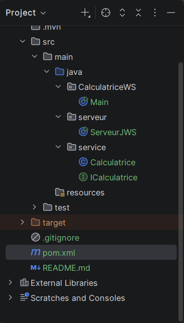
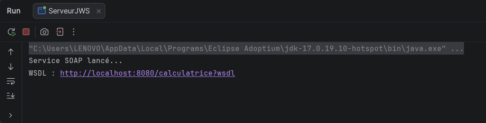
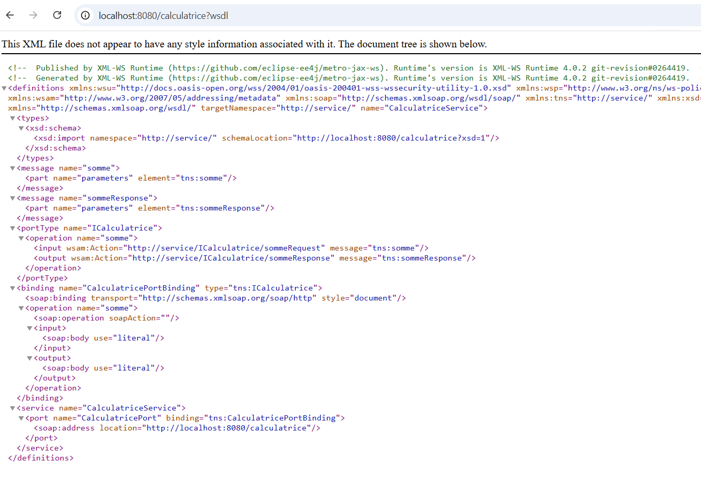
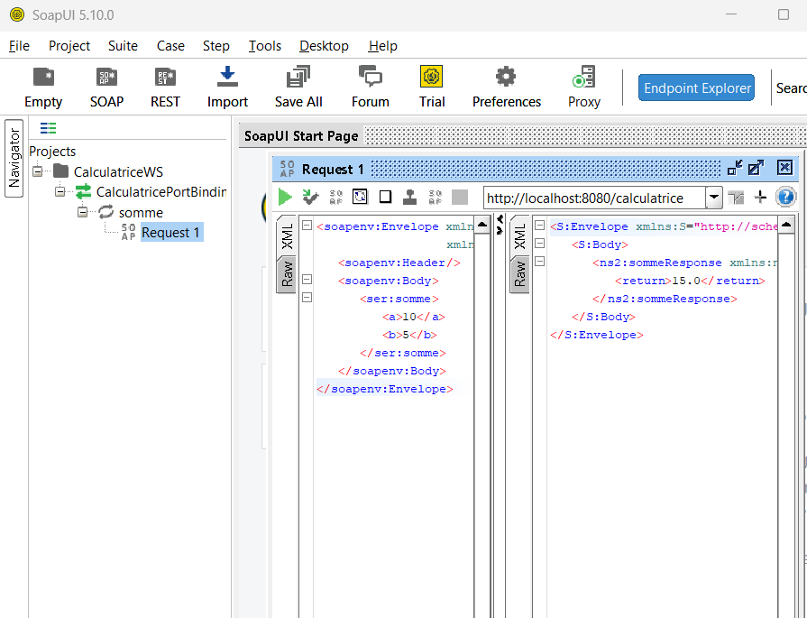
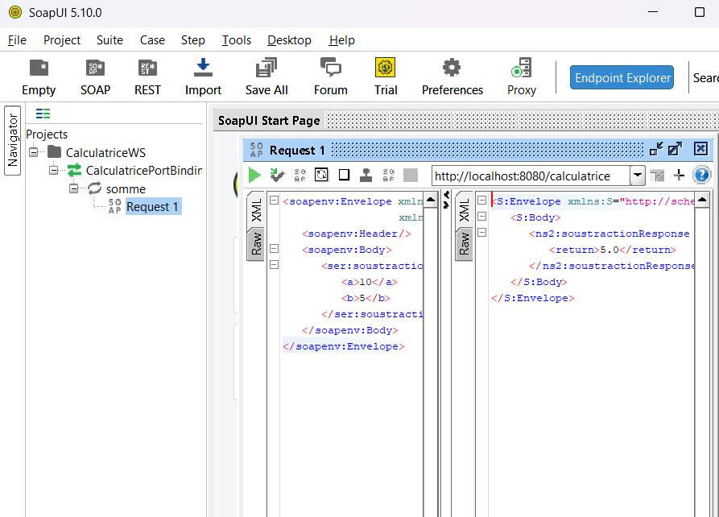
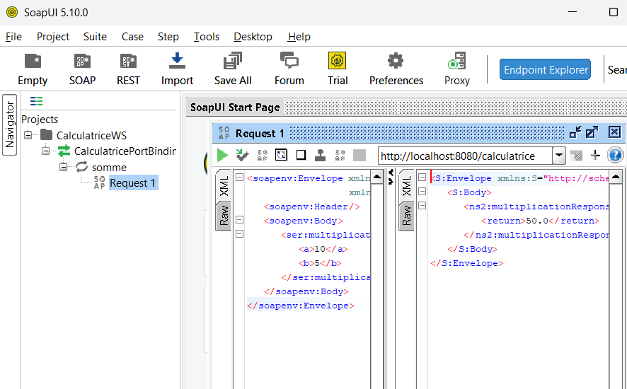
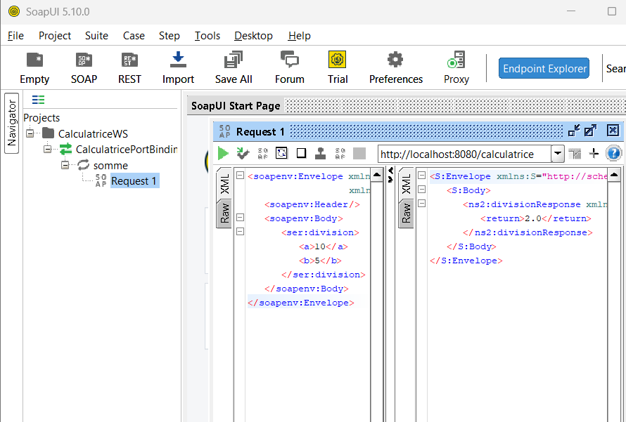
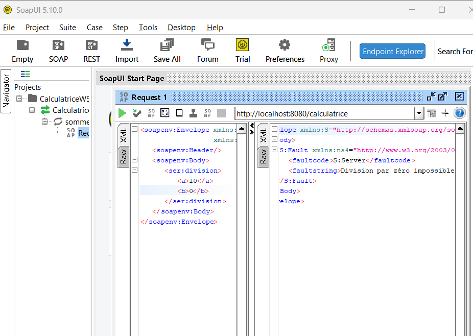

# TP2 : Mise en œuvre de Jakarta XML Web Services

**Matière :** Architecture SOA et services web 

**Réalisé par :** Emna Zayen

Service web SOAP **CalculatriceWS** (somme, soustraction, multiplication, division) développé avec Jakarta XML Web Services, publié avec `Endpoint.publish` et testé avec SoapUI.

---

## Structure du projet

---

## Publication du service

### Service en cours d'exécution et WSDL généré

---

## Test avec SoapUI

### Projet SoapUI (WSDL importé)

### Somme

### Soustraction

### Multiplication

### Division

### Division par zéro 

---

